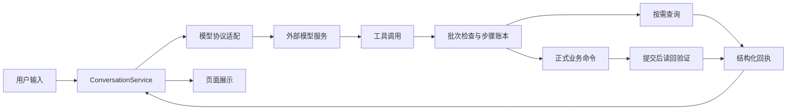
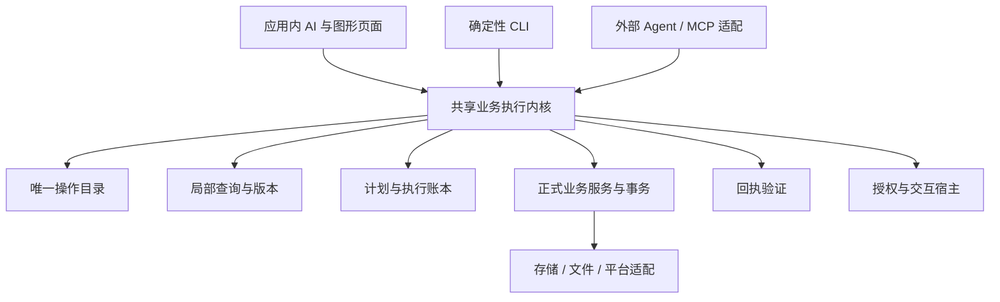

# 可复用 AI 接入规范

更新时间：2026-10-22（Asia/Shanghai）。现状基线：Callring `0.4.1 / versionCode 15`，源码提交 `ecdbd38260554d2046d00050bf2da96f3a8b67f9`。

本文将项目现有经验整理为其它项目可采用的接入规范。第 1–3 节描述已实现的架构与执行规则；第 4 节分析历史效率；第 5–8 节给出优化与跨宿主设计，第 9–10 节提供复现及验收步骤。优化项、CLI、MCP、通用模块拆分和跨进程账本均为待实施设计，不表示当前版本已经具备这些能力。本文属于文档交付，不改变运行行为、工具协议、数据库或版本。

## 1. 目标与适用边界

目标是让自然语言、图形页面、命令行和外部 AI 客户端共用同一套可信业务能力，同时控制上下文成本、重复执行和结果误报。

接入原则：模型负责理解需求、选择操作和生成参数；本地程序负责授权、校验、版本检查、事务、提交与结果核验。提示词辅助模型遵守流程，实际执行边界必须由程序实现。

适合需要查询或修改结构化业务数据的应用。纯聊天产品可以只采用模型连接和上下文管理；录音或文档分析可以采用独立处理工作流，无需开放业务写工具。当前方案为轻量工具调用循环，没有引入向量检索、通用多 Agent 调度或 MCP 服务。

## 2. 现有架构

### 2.1 模块职责

| 模块 | 当前职责 | 复用时保留的边界 |
| --- | --- | --- |
| `contracts` | 纯 JVM 公共 DTO、查询、命令、回执、变更订阅及能力接口 | 不包含网络、SQL、凭据存储和业务实现 |
| `backend/application` | 业务服务、窄端口、会话编排、操作目录、查询及验证 | UI、AI、后台任务共用正式业务入口 |
| `backend/domain` | 独立业务算法和策略 | 不依赖 application、contracts、Android 或 UI |
| `ui` | Compose 页面、状态、对话展示和前台交互 | 通过 contracts 使用业务能力，不直接访问 backend 或存储 |
| `app` | 唯一装配、数据库、偏好、文件、HTTP、Android 平台与生命周期适配 | 平台实现可替换，业务规则不在适配层复制 |

模块依赖为 app 组合 ui/backend/contracts，ui 与 backend 仅依赖 contracts。完整规范以 [PROJECT.md](../PROJECT.md) 为准。

### 2.2 AI 沟通链路



1. 页面展示当前分析连接目标，发送时服务再次核对。连接变化会停止活动请求并清理旧匹配历史。
2. 每个用户回合初始只启用 `discover_tools`。普通聊天可以直接回复，业务任务按需发现工具，再查询或执行。
3. 当前目录共 **81 项操作：49 项写操作、32 项非写操作**。非写操作包括 29 项来源读取、1 项计算、1 项目录发现和 1 项内存计划。操作以具名 `OperationId` 识别，不按目录位置或数字编号分派。
4. 查询覆盖 D01–D21：档案、职位、通话、统计、工作安排、日历、请假、设置、外观、铃声、录音、AI 安全配置、授权目录、组件、运行状态、诊断及审计。
5. 多项写入建立完整计划，批次检查参数与依赖，逐步执行并记录结果。批次允许部分提交，不承诺跨全部步骤的整体事务。
6. 写入复用正式业务 API，成功提交后按操作策略读回；业务层发布累计领域/实体失效，使页面、悬浮窗和组件刷新。
7. 本地任务账本和回执决定是否完成。工具调用伴随的模型文字不构成保存成功证据。

当前普通对话不会自动发送完整 21 域快照；显式完整快照能力仍单独存在。分页或分块未完成时，不能以当前页代替全集，也不能把权限不足、未配置或读取失败解释为空数据。

### 2.3 模型协议和上下文

| 项目 | 当前行为 |
| --- | --- |
| 沟通及内容分析 | OpenAI `chat/completions`、Anthropic `messages` 兼容协议 |
| 录音转写 | OpenAI 兼容 `audio/transcriptions` |
| 地址 | HTTPS 基础地址；保留用户版本及代理前缀，只追加端点，不自动追加 `/v1` |
| 凭据 | Android Keystore 加密；模型视图只暴露配置状态，凭据通过本地表单编辑 |
| 响应处理 | 有界读取完整 JSON 后校验；当前无文本流式输出；兼容性以对应协议和模型测试为准 |
| 会话历史 | 当前进程内保留；UI 历史与模型协议历史分离，结束回合采用本地摘要，无额外总结模型请求 |
| 大结果 | 已发送过且超过 4096 字节的工具结果在后续协议历史中改为引用提示；需要业务值时重新查询 |
| 历史保留 | 已结束回合最多 100 轮，UI 保留估算最多 2 MiB；不代表模型请求必然能容纳全部摘要 |
| 默认预算 | context=49152、output=4096；旧显式配置保留；按实际编码 UTF-8 字节加开销、输出预留和安全余量估算 |
| 硬限制 | 请求 8 MiB、响应 1 MiB；每轮最多 16 次模型请求、64 个工作量单位；源查询也计入工作量 |
| 批次与修复 | 模型工具批次最多 32 调用，档案批处理展开最多 64 子调用；仅未开始步骤的明确参数错误允许有限修复，每步 2 次、每轮 4 次 |

上下文预算是保守的客户端估算，不等于精确 Token 数或服务模型实际容量。达到任何限制均明确返回，不能减少用户要求数量、遗漏数据或重放已提交步骤以绕过限制。

### 2.4 录音归档链路

录音处理独立于聊天：导入或采集 → 转为 16 kHz 单声道 WAV → 每五分钟分段转写 → 按约 32000 字符分段分析 → 两两合并分析 → 保存归档。音频与转写分别发送到用户配置的转写、分析服务。

工作流持久化归档状态、完整转写、尝试次数及下一次重试时间；用 generation 和 compare-and-set 防止删除、替换或取消后的迟到结果覆盖新状态。网络工作不跨数据库事务。临时失败有限退避重试；已有完整转写可供分析重试复用。

限制包括两小时音频、256 MiB 导入、256000 字符转写。当前未逐段持久化转写和分析中间结果，失败后可能重复调用已完成片段。转写分成 N 段不意味着分析也是 N 段；分析若分为 N 段，当前二叉合并算法共需约 `2N−1` 次分析请求，这是代码推导而非性能实测。

### 2.5 当前复用缺口

- 没有正式业务 CLI、MCP 服务或可直接分发的通用 AI SDK；`tools/verify_*.py` 是验证工具。
- 49 项 AI 写操作均要求前台宿主。直接启动无界面进程会等待前台或拒绝，不能靠伪造前台状态适配。
- `ToolExecutor` 仍依赖 `CallringUiApi`，目录、查询域、确认目标和提示词包含本项目业务知识。
- HTTP/JSON 编码器目前位于 app 模块，复用到 JVM 命令行前需要提取平台无关部分并替换存储、凭据及文件能力。
- 聊天步骤账本和任务续办在内存中。业务修改落盘不等于任务账本可以跨进程恢复，也不能据此承诺 exactly-once。

## 3. 通用接入规则

本节的“必须”是采用本规范时应实现的约束；跨进程及其它宿主的新增机制见后文设计，不表示 Callring 已全部具备。

### 3.1 唯一操作目录

每项操作必须有下列声明，并在启动时检查重复、缺失或策略不一致：

| 声明 | 作用 |
| --- | --- |
| 稳定业务 ID、外部工具名、协议版本 | 识别操作和维护兼容性，展示顺序不参与分派 |
| 参数 Schema、必填字段、缺省语义 | 拒绝未知字段和非法类型；区分未传、null、空值 |
| 读写性质及来源/执行绑定 | 指向正式业务命令、查询或纯计算 |
| 作用域及预期版本 | 明确涉及哪些资源、实体和字段，防止旧读取覆盖新修改 |
| 授权与交互策略 | 声明是否需要本地目标确认、凭据编辑或系统交互 |
| 核验及回执策略 | 声明验证何种持久状态或外部结果，异步完成如何观察 |

目录、执行、作用域、确认和验证必须解析同一份定义；模型不能提供任意 SQL、代码、Intent 或 shell 字符串代替已登记操作。业务 ID 与一次执行的 ID 要区分：当前 `OperationId` 是操作类型，而 `ToolReceipt.operationId` 是执行实例标识。

### 3.2 查询和数据披露

- 闲聊不触发业务读取。查询只读取任务所需范围，长文本通过短期引用分块获取。
- 分页返回来源版本、范围、时间、完整性与下一游标；聚合必须基于匹配全集，不能对当前页求和冒充总量。
- `EMPTY`、`PARTIAL`、`NOT_CONFIGURED`、`DENIED`、`UNAVAILABLE` 分开表达；游标过期或源版本改变明确报错。
- 业务文本、录音转写、历史摘要和工具数据均按不可信内容处理，不能授予权限。用户授权来自可信宿主与本地策略。
- 不向模型输出密钥、私有音频路径或可调用 URI。目录文件使用短期句柄，使用前重查目标和授权。
- 显式全量导出/快照与普通查询隔离，单独检查披露范围、容量、完整性和调用授权。

### 3.3 写入与结果

写入路径必须是：Schema 校验 → 计划/依赖检查 → 读取权威目标及作用域版本 → 按策略授权 → 提交前再次校验 → 正式业务事务 → 发布实际变更 → 读回验证 → 保存回执。

提交前取消或过期不得继续写入；提交成功后的取消不能伪装成回滚。资源关闭应先封口、取消可取消任务、按约定排空已接收写入，再释放资源；关闭后的 owner 不得重新打开存储。

| 本地结果 | 对外语义与后续动作 |
| --- | --- |
| `READ` | 返回真实读取及完整性信息；查询未完不能宣称全集完成 |
| `COMMITTED / VERIFIED` | 写入已经核验，可计入完成数量；外部动作按其专用证据判断 |
| `COMMITTED / COMMITTED_UNVERIFIED` | 已提交，验证失败或不足；只允许核对，禁止重新写入 |
| `QUEUED`、`LAUNCHED` 且核验 `PENDING` | 已受理或已发起，继续观察；不能宣称安装、上传或后台工作已完成 |
| `DENIED`、`CANCELLED`、`SKIPPED`、`FAILED` | 保留具体原因及已完成步骤；失败标签不自动代表不存在副作用 |
| `UNKNOWN` | 提交结果未知，阻止同效果自动重试，先查询或人工核对 |

`noOp` 只有在权威状态已经符合目标且核验通过时才能按完成处理。多项任务保留用户原始数量，返回逐项状态与已核验数量；批次错误不允许静默丢弃尾部操作。

### 3.4 重试与兼容

同一执行 ID 携带不同参数必须拒绝；同一任务内等价效果使用规范化签名去重。仅明确允许的未开始步骤参数错误可修复，不能改变目标或任务数量。会话网络错误不自动重放写操作；独立录音工作流按其持久状态及有限退避策略恢复。

外部工具名、Schema、缺省语义及回执属于兼容契约。Callring 的 81 项协议基线冻结于 [ai-operation-compatibility.json](contracts/ai-operation-compatibility.json)，必须经过协议变更审查才能更新，不能为通过测试直接重生成。

## 4. 效率证据与判断

历史真机模型样本来自 2026-10-19、提交 `346e896`，记录的连接为 `qwen3.8-flash / OPENAI / QWEN_FAST`，使用已有 context=1048576/output=16384；不是默认预算或当前 0.4.1 的重新测速。

| 输入 | HTTP 次数 | 源查询 | 工作量 | 核验写入 | 请求字节合计 | HTTP 耗时合计 |
| --- | ---: | ---: | ---: | ---: | ---: | ---: | ---: |
| 你好 | 1 | 0 | 0 | 0 | 4023 | 2384 ms |
| 添加 10 个随机号码档案 | 4 | 40 | 52 | 10 | 38719 | 15518 ms |
| 修改深色模式 | 5 | 3 | 7 | 1 | 48418 | 7270 ms |

来源：[AI 沟通整改验收](plans/AI沟通整改验收.md)。HTTP 耗时是 exchange 之和，不是完整用户等待时间；旧运行缺失部分步骤 ID、Schema 数量和完整阶段时序，不能推测补齐。这三个样本不能证明平均性能、P95、费用或所有模型兼容性。

可以据此确定优化调查方向：闲聊零业务读取已经有效；单次外观修改仍经历多轮请求，应优先检查工具发现和调用安排；十条写入的源查询包含范围检查、存在性检查及读回，优化前需分解用途。不能把 HTTP 时长当作总耗时，也不能把调用范围/消费行数当作 SQLite 物理扫描量。

## 5. 优化优先级

下表除文档同步外均待实施，收益必须用同任务、同数据规模和同模型配置复测。

| 优先级 | 工作 | 实施方向 | 验收条件 |
| --- | --- | --- | --- |
| P0 | 现状与证据一致 | 同步 README、工具数量、上下文策略；历史记录保留原版本和限制 | 文档与目录/源码一致，建议功能不写成已实现 |
| P1 | 减少简单任务模型往返 | 小任务预选有限工具；缓存发现结果，按目录版本、连接和能力授权失效 | 对照任务请求数下降，闲聊仍零源查询，未知操作仍失败 |
| P1 | 减少重复 Schema | 发现回执和请求 tools 存在重复；保证首次获取及调用配对后，压缩重复历史表示 | 实际 Token/字节下降，旧工具调用仍能正确配对和验证 |
| P1 | 建立端到端基准 | 采集排队、模型、查询、确认等待、事务、验证和渲染耗时 | 固定任务输出端到端与 HTTP 分项、完成率、请求数、usage、缓存及缺失项 |
| P2 | 精细预算 | 增加按模型的 Token 估算并用实际 usage 校准；保留字节硬限制和余量 | 大文本、中英文、完整 Schema 和边界请求不静默截断，超限明确失败 |
| P2 | 分段断点恢复 | 保存转写、分析及合并节点进度，键包含内容摘要和连接/处理策略版本 | 中断后只补缺失节点；内容/配置变化使缓存失效；删除阻止迟到回写 |
| P2 | 减少重复本地读取 | 先计量用途，再合并必要范围查询或采用有版本约束的批量预检/读回 | 保留逐项验证、并发冲突和局部访问；无关 loader 增量仍为零 |
| P3 | 流式文本与有限并行 | 文本流式展示；仅在独立范围和一致性边界明确时并行只读/分析任务 | 未完整校验的工具参数不执行；取消、顺序、并发和限流测试通过 |

不通过删除读回、扩大写权限、减小原始任务数量、全量加载或无条件重试换取速度。不因接入 AI 就引入大型框架或多 Agent；先证明现有循环存在必须由其解决的问题。

## 6. 跨宿主目标设计（待实现）

### 6.1 复用边界



“共享内核”是需要从现有调用链抽取的能力边界，不是当前已有的新模块。不能直接调用裸 `ToolExecutor` 而跳过 `ToolBatchEngine`、作用域或读回验证。图形页面保留正式业务服务；AI、CLI、MCP 的工具执行共用统一计划、版本、授权和回执流程。

建议新增或提取的能力：

| 能力 | 职责 |
| --- | --- |
| 操作绑定 | 将目录中的稳定 ID 绑定到项目业务命令与核验器，移除通用核心对 `CallringUiApi` 的依赖 |
| `ExecutionHost` | 声明宿主身份、可用能力、生命周期及取消；不默认假定 Android 前台存在 |
| `UserInteractionPort` | 获取权威目标确认、文件选择、凭据编辑或系统交互结果；一次消费并绑定目标/版本/期限 |
| 持久执行账本 | 在接受可能产生副作用的操作前记录执行 ID、规范化签名和状态，恢复后核对提交结果 |
| 模型协议适配 | 单独处理 HTTP/JSON、usage、错误、取消和协议兼容，不拥有业务权限 |
| 数据适配 | 按项目提供数据库、目录、凭据和平台能力，关闭后拒绝再次初始化 |

当前协议不随本文改变。实现新宿主及跨进程信封时必须评审参数和授权语义，不能给旧工具 Schema 随意加控制字段。

### 6.2 交互能力

| 操作 | Android 宿主 | 终端/MCP 宿主设计 |
| --- | --- | --- |
| 普通查询 | 按授权读取 | 按可信身份与工具范围读取 |
| 普通业务写入 | 当前需要前台宿主，按目录决定是否另行确认 | 由明确的宿主写策略授权；模型不能自行批准 |
| 删除等目标确认 | 展示本地读取的目标；号码删除两次确认 | 可信终端或设备端展示同一目标与影响，必要确认次数保持；无交互能力时拒绝 |
| 文件和凭据 | SAF/本地表单 | 本地文件交互和凭据存储；不得让模型提交任意路径或聊天密钥 |
| 权限、角色、组件固定 | Android 系统页面 | 转设备端交互；无法完成则返回不可用或待处理 |

所有入口必须提交同一条业务命令并取得真实回执。不能以终端 `--yes`、MCP 客户端批准或模型声称“用户已同意”自动替代业务规定的目标确认。

## 7. CLI 与 MCP 接入设计（待实现）

### 7.1 确定性业务 CLI

第一阶段先提供无需模型的 CLI，便于脚本、调试和自动验收。以下是拟定接口，当前仓库没有 `callring-cli` 可执行文件：

```text
callring-cli tools list --format json
callring-cli query --domain D11 --format json
callring-cli invoke settings_saveAppearance --arguments-file appearance.json --operation-id <UUID>
callring-cli operation get <UUID> --format json
```

`appearance.json` 的业务参数示例为 `{"colorMode":"DARK"}`，必须符合目录 Schema。`--operation-id` 属于执行信封，不能注入工具参数；重复提交必须复用原 ID。传输层 session、可信主体及授权绑定同属信封，不能由模型参数伪造。

输出采用单份版本化 JSON，stdout 只放结果，诊断写 stderr；保留执行 ID、工具调用 ID、结果状态、核验状态、完整性、提交版本、变更范围和安全错误信息。日志不输出业务全文或凭据。先提供单操作，再开放显式计划的批次接口，原始数量和逐项回执不得丢失。

拟定退出码：0=读取完整或效果已核验；2=参数错误；3=不可用、未完成或仍为 PENDING；4=拒绝；5=版本冲突；6=提交结果未知；1=其它失败；130=用户中断。非零退出码不证明没有副作用，脚本必须根据执行 ID 查询状态，不能直接重发。异步操作如提供等待选项，超时保留同一 ID 和待完成状态。

CLI 与手机是两个运行环境：桌面 JVM 不会自动获得应用数据库、Keystore 和 Android 权限。访问手机现有数据需增加受控设备桥接，让操作在应用进程内通过正式业务入口执行；开发时可以评估 ADB 转发。不得用桌面进程直接修改手机 SQLite 文件。

### 7.2 MCP 适配

推荐让已有外部 AI 客户端负责模型循环，MCP 服务只负责发现、执行、授权与回执，复用第 6 节内核。无需在 MCP 工具内部再启动一次 `ConversationService` 模型循环。

| 协议面 | 映射要求 |
| --- | --- |
| 工具发现 | 从唯一目录生成名称、说明和输入 Schema；按可信身份/能力过滤，不维护第二份清单 |
| 工具调用 | 将协议调用映射到共享执行内核，保留计划、版本、授权、去重和核验 |
| 结果 | 返回结构化业务回执；区分传输成功、业务提交及效果完成，PENDING 不转成已完成 |
| 会话和重连 | 将协议请求 ID 与稳定执行 ID 分开，重连不视为新业务操作；持久账本防止重复执行 |
| 取消和超时 | 停止未提交工作，已提交步骤保留结果；断连或取消不等于回滚 |
| 能力限制 | 不支持的宿主能力明确拒绝；工具只读/破坏性标注用于客户端提示，服务端仍独立授权 |

MCP 发现不能自动保证上下文更省：客户端可能把全部工具 Schema 一起发送。首版优先固定的小范围授权工具集；若引入动态发现/加载，需验证目标客户端支持情况，重新测量实际发送内容，不能照搬应用内 `enabled` 集合就宣称兼容。

传输优先本机 STDIO；跨设备服务再考虑 Streamable HTTP、身份认证与能力范围。STDIO 的 stdout 只发送协议消息；跨设备连接鉴权不能代替具体业务确认。超时重试必须查原执行状态，尤其不得重放 UNKNOWN 或 COMMITTED_UNVERIFIED 写入。

截至 2026-10-22，[OpenAI 官方 MCP 文档](https://learn.chatgpt.com/docs/extend/mcp?surface=cli)说明 Codex CLI 支持 STDIO 与 Streamable HTTP。以下只展示服务实现并打包后的配置方式，`callring-mcp.jar` 当前不存在：

```powershell
codex mcp add callring -- java -jar callring-mcp.jar
```

### 7.3 AI 命令行作为模型后端

可另行实现进程形式的 `ConversationClient`，但必须使用目标 CLI 明确支持的结构化接口，处理进程启动、输入输出、超时、取消、会话和凭据。普通自然语言 stdout 不能直接当成工具协议，模型生成文本不得拼接执行为 shell 命令。

对 Callring Android 应用，这不是更换一个 HTTP 地址即可实现的能力，也不能假设手机能运行桌面 CLI。跨项目优先采用“外部 AI 命令行 → MCP → 业务内核”；只有明确需要本项目拥有模型循环且目标运行环境支持时，再实施进程后端。

## 8. 持久任务与分段恢复设计（待实现）

跨进程 CLI/MCP 写入上线前，必须补齐以下机制：

1. 接受操作前持久化可信主体、任务 ID、执行 ID、参数摘要、目标及原始期望数量，拒绝 ID 改参或跨主体复用。
2. 存储支持时，将业务提交与执行结果记录放在同一事务；跨资源副作用保留明确提交证据及核对路径，无法判断则标为 UNKNOWN。
3. 恢复 PREPARED 步骤前重新授权及检查版本；恢复 STARTED/COMMITTED 步骤先核对真实效果，不能直接重新执行。
4. 任务继续沿用原始计划和已提交步骤。续办刷新预算不代表允许增加数量、覆盖冲突或重写已提交项。
5. 明确保留期和清理策略，并写入部署配置；过期后拒绝自动重放，旧 ID 缺失不作为“从未提交”的证据。上线验收须覆盖保留期边界。
6. 录音中间节点以音频/文本摘要、分段范围、模型连接及处理策略版本标识；保留各段和合并节点进度。复用必须检查来源和权限，删除同时终止上传及迟到保存。

这些机制提供可恢复和防重复的工程保证，不直接宣称跨系统 exactly-once。真实进程强杀、网络断连和外部系统失败需要单独验收。

## 9. 其它项目复现步骤

先用一个查询、一个修改和一个目标确认操作形成完整闭环，再扩展目录；不要求新项目复制 Callring 的 21 域或 81 项操作。

| 步骤 | 产物 | 完成条件 |
| --- | --- | --- |
| 1. 确定边界 | 业务能力/数据披露/风险清单，宿主与模型支持表 | 明确 AI 能读写什么、由谁授权、哪些动作必须本地交互 |
| 2. 建立业务入口 | 正式命令、查询、事务和变更订阅 | UI 与自动化共用规则；能独立完成及验证一个读写用例 |
| 3. 定义公共契约 | 查询来源/游标、命令上下文、错误、回执 | 非空与失败可区分，来源版本和实际完成状态可追踪 |
| 4. 建立操作目录 | 稳定 ID、Schema、绑定、作用域、确认、核验 | 缺声明/重复 ID 启动失败；额外参数拒绝；冻结首版协议基线 |
| 5. 接局部数据源 | 分页、详情、权威聚合、文本分块 | 大数据不全量加载，尾页和长文尾部可读，失效游标拒绝 |
| 6. 接执行内核 | 计划、账本、版本检查、正式提交与读回 | 单写、批量、冲突、取消、去重和部分提交用例闭合 |
| 7. 接模型 | 一个协议适配、预算、usage、错误分类、取消 | 先使用受控响应测协议，再按授权做真实模型用例；凭据无出站泄漏 |
| 8. 接宿主 | 页面或终端的授权/文件/确认能力 | 无交互时明确拒绝，不虚构系统完成结果 |
| 9. 接 CLI/MCP | 共享内核的薄适配、持久账本、身份边界 | 三种入口同输入得到一致业务效果和回执；断连重试不重复写入 |
| 10. 发布基线 | 文档、兼容基线、自动门、性能样本和设备限制 | 源码提交/产物/证据绑定，列明真实模型与平台未验证项 |

建议在新项目保存 `docs/ai-integration.md`，至少包含模块依赖、数据范围、工具目录、授权矩阵、状态/重试语义、预算、兼容基线和验收入口。先复用设计与测试场景；出现第二个真实项目后，再按稳定共性提取共享库。

## 10. 验收与维护

### 10.1 最小验收矩阵

| 场景 | 必须证明 |
| --- | --- |
| 闲聊 | 一次模型直答可完成，业务查询/完整快照/平台探测增量为零 |
| 单项修改 | 正式业务提交、精确失效、读回一致，无关查询/loader 不增加 |
| 批量修改 | 原始数量保持、每步回执可追踪，超额/依赖循环在副作用前拒绝 |
| 参数错误 | 未知字段/错误类型拒绝，有限修复保持目标，非法输入不修改业务 |
| 重复和未知提交 | 同 ID 改参拒绝、换调用 ID 等价效果去重；已提交未核验及未知状态不重放 |
| 并发和授权 | 旧版本、目标变化、过期确认、宿主替换、重复/迟到结果均不能越权提交 |
| 查询完整性 | 空、拒绝、未配置、部分、不可用不同；分页/全文尾部与权威总量正确 |
| 容量与协议 | 截断、非法 JSON、超限、服务拒绝不触发错误执行；工具结果配对完整 |
| 生命周期 | 取消不保存迟到结果；已接收写入按约定排空；关闭后不重开资源 |
| CLI/MCP 扩展 | 重启、断连、超时及重复请求不重复修改；未经授权的工具不可调用 |
| 真实平台/模型 | 分别验证支持的服务、权限/文件/组件、录音及后台场景；测试替身不能替代 |

### 10.2 性能记录

固定记录任务原文或脱敏场景 ID、源码提交、数据规模、设备、模型与协议、预算/思考配置、请求和响应字节、实际 input/output/cache usage、源查询、写入/核验数、修复数、HTTP 耗时、端到端耗时及用户确认等待。服务未返回或采集缺失的字段保留 null，不推测补齐。

多次运行后再计算完成率和 P50/P95；调用费用按当时实际计费记录核算。写入基准使用独立合成数据和固定任务标识，避免重复添加真实资料；只读复验与付费执行分开。

### 10.3 Callring 验证入口及证据边界

代码实施完成后在项目根目录运行现有统一门：

```powershell
python tools/verify_backend.py
```

设备场景使用 [PROJECT.md](../PROJECT.md) 和 [README](../README.md) 中的隔离设备流程；真实模型验证入口为 [verify_ai_device.py](../tools/verify_ai_device.py)，其中付费执行需要明确授权，该脚本不能作为通用 CLI 或随意重跑的写入基准。

当前分层、局部读取、刷新、生命周期及隔离设备结果见 [分层验收](plans/layer-boundaries-evidence/acceptance.md) 和 [设备复验](plans/layer-boundaries-evidence/device-fix-review.md)。历史真实模型只证明已记录的任务与版本；主题预设及聊天空白修复见 [主题验收](plans/AI主题预设修复验收.md) 和 [空白修复验收](plans/AI沟通空白修复验收.md)，未新增真实模型验证。真实 SIM、长时间待机、系统交互、升级等未测项继续保留原限制。

纯文档交付的本地校验检查文档内容、链接、源码定位和差异，不调用模型或设备，也不额外运行应用测试；提交后仍按项目规则确认远端统一 CI。CI 的应用回归结果不能替代真实模型、设备或新增能力验收。CLI/MCP、跨进程恢复及优化效果均不得据本文标记为验收通过。

## 11. 实现索引

| 主题 | 当前源码/文档 |
| --- | --- |
| 目录及声明 | [OperationCatalog](../backend/src/main/kotlin/com/greatwall/callring/application/conversation/operation/OperationCatalog.kt)、[OperationDefinition](../backend/src/main/kotlin/com/greatwall/callring/application/conversation/operation/OperationDefinition.kt)、[CapabilityCatalog](../backend/src/main/kotlin/com/greatwall/callring/application/conversation/operation/CapabilityCatalog.kt) |
| 会话与批次 | [ConversationService](../backend/src/main/kotlin/com/greatwall/callring/application/conversation/execution/ConversationService.kt)、[ToolBatchEngine](../backend/src/main/kotlin/com/greatwall/callring/application/conversation/execution/ToolBatchEngine.kt)、[ToolExecutor](../backend/src/main/kotlin/com/greatwall/callring/application/conversation/execution/ToolExecutor.kt) |
| 版本、去重及核验 | [OperationScopePlanner](../backend/src/main/kotlin/com/greatwall/callring/application/conversation/execution/OperationScopePlanner.kt)、[StepLedger](../backend/src/main/kotlin/com/greatwall/callring/application/conversation/execution/StepLedger.kt)、[ReceiptVerifier](../backend/src/main/kotlin/com/greatwall/callring/application/conversation/execution/ReceiptVerifier.kt) |
| 局部查询 | [AiQueryApi](../contracts/src/main/kotlin/com/greatwall/callring/contracts/ai/AiQueryApi.kt)、[QueryService](../backend/src/main/kotlin/com/greatwall/callring/application/conversation/query/QueryService.kt) |
| 上下文及预算 | [ContextAssembler](../backend/src/main/kotlin/com/greatwall/callring/application/conversation/context/ContextAssembler.kt)、[ContextBudget](../backend/src/main/kotlin/com/greatwall/callring/application/conversation/context/ContextBudget.kt)、[TurnBudget](../backend/src/main/kotlin/com/greatwall/callring/application/conversation/context/TurnBudget.kt) |
| 模型适配 | [ConversationClient](../backend/src/main/kotlin/com/greatwall/callring/application/ports/platform/ConversationPorts.kt)、[CompatibleConversationClient](../app/src/main/kotlin/com/greatwall/callring/platform/ai/CompatibleConversationClient.kt)、[CompatibleAiClient](../app/src/main/kotlin/com/greatwall/callring/platform/ai/CompatibleAiClient.kt) |
| 宿主和装配 | [ConversationApi](../contracts/src/main/kotlin/com/greatwall/callring/contracts/ai/ConversationApi.kt)、[ForegroundActionService](../backend/src/main/kotlin/com/greatwall/callring/application/conversation/foreground/ForegroundActionService.kt)、[ConversationAssembly](../app/src/main/kotlin/com/greatwall/callring/bootstrap/ConversationAssembly.kt) |
| 录音工作流 | [RecordingWorkflow](../backend/src/main/kotlin/com/greatwall/callring/application/recording/RecordingWorkflow.kt)、[AndroidAudioTranscriber](../app/src/main/kotlin/com/greatwall/callring/platform/recording/AndroidAudioTranscriber.kt) |
| 兼容与现状 | [current-api](contracts/current-api.md)、[冻结协议基线](contracts/ai-operation-compatibility.json)、[目录约束测试](../backend/src/test/kotlin/com/greatwall/callring/OperationCatalogTest.kt)、[协议基线测试](../backend/src/test/kotlin/com/greatwall/callring/ToolCompatibilityBaselineTest.kt) |
